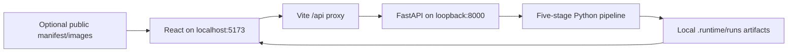

# Integrated application architecture

The approved scope now includes the team's local Python pipeline and a connected frontend.

After a production build, the API can also serve dist/ directly on port 8000. Neither path has been deployed publicly.

## Responsibilities and boundaries

| Component | Responsibility |
| --- | --- |
| src/components/PublishedObservations.tsx | Curated target selection, spherical region matching and reviewed comparison-group selection |
| src/components/AnalysisWorkbench.tsx | Upload/settings form, processing state, rankings, metadata and downloads |
| src/components/ObservationViewer.tsx | Shared playback, timeline, image layers and pixel overlays |
| src/services/ | HTTP/static loading, runtime response validation and coordinate matching |
| backend/app.py | Multipart input bounds, single-run lock, API errors and artifact/static serving |
| backend/analysis.py | File checks, time ordering, stage orchestration, valid-footprint masking and JSON/image exports |
| moving_object_pipeline.py | Alignment, cleaning, significance, track metrics and heuristic reporting |
| public/observations/ | Optional curated data; currently empty |
| .runtime/ | Generated local run artifacts, excluded from Git |

Ryan owns integration/API boundaries; Artem owns the scientific pipeline; Theo owns UI; Niyati validates data/interpretation; Pranav owns documentation/demo preparation.

## Decisions and trade-offs

The pulled Python script had no network interface. FastAPI is the smallest added application service here that handles uploads, parameter validation, explicit errors and generated API documentation.
Uvicorn serves it; python-multipart parses browser uploads. There is still no database, auth or task-queue framework.

The root Vite app is the single integrated frontend. The sky/ Next.js prototype remains intact; its interaction concepts were connected in the root app without importing placeholder astronomy data or maintaining two active frontend frameworks.

A Vite proxy gives the browser one origin and avoids a development CORS configuration. Node's built-in child_process starts both services, avoiding another npm process-management dependency.

Analysis is synchronous and bounded to small batches. A nonblocking lock returns 409 for concurrent requests. This favors a reliable local demonstration over multi-user scalability. Disconnecting the browser does not cancel an already running Python calculation.

Generated artifacts live in UUID run directories. Raw uploads are temporary. There is no persistent job registry, user history, automatic cleanup or storage service.

## Scientific and operational constraints

A valid request and finite output do not certify scientific comparability. The UI exposes approximate significance and heuristic ranking with explicit caveats.
Complete real timestamps produce pixel/day metrics; incomplete times use frame units consistently. No date is invented.
Different curated comparison groups cannot be played as one sequence.

Live arbitrary-coordinate archive acquisition remains absent. The coordinate search only matches target centers from the curated manifest.
The API output and curated publication contract are different interfaces; publishing real data still needs review.

See [the code walkthrough](CODEBASE.md), [infrastructure](INFRASTRUCTURE.md) and [API/mathematics](INTEGRATION.md) for operational detail.
